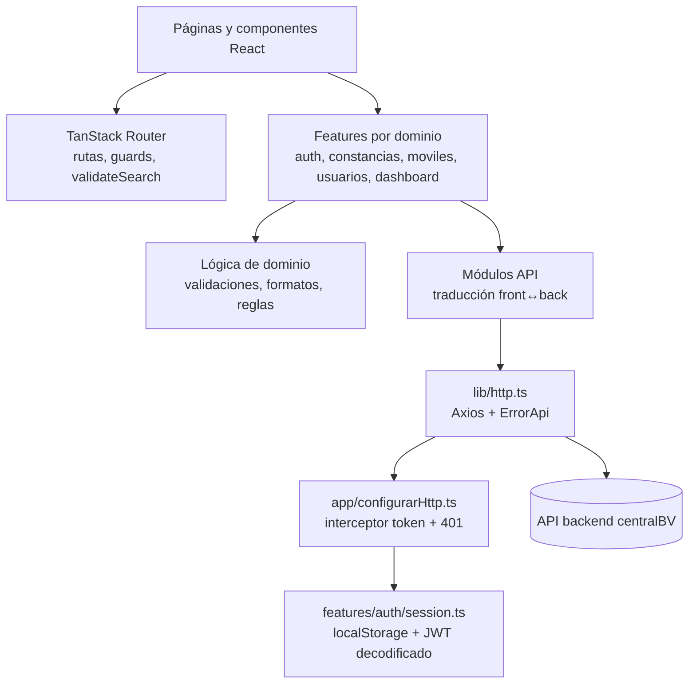

# centralBV — Frontend
[](https://github.com/rodripavon97/centralBV/actions/workflows/ci.yml)
[](https://codecov.io/gh/rodripavon97/centralBV)

Aplicación web (frontend) para la gestión operativa de un cuartel de bomberos voluntarios. Este repositorio contiene exclusivamente la interfaz construida con React; consume los servicios HTTP expuestos por el backend de centralBV.

## Objetivo del frontend

Brindar una interfaz clara para el trabajo administrativo y operativo del cuartel, con foco en:

- acceso con sesión autenticada y recuperación de contraseña;
- gestión de solicitudes de constancias de actuación (alta, edición, estados, pago, generación/descarga de PDF, entrega);
- gestión de móviles de emergencia (listado, ficha, alta/edición según permisos, revisiones);
- administración de usuarios y roles (acceso restringido a administradores);
- panel inicial (dashboard) con información de flota.

## Funcionalidades implementadas (según el código)

- **Autenticación**: inicio de sesión, cierre de sesión, aviso de sesión vencida, flujo de recuperación/restablecimiento de contraseña (rutas públicas y pantalla de confirmación).
- **Solicitudes de constancia**: listado con búsqueda/filtros/orden/paginación en URL, creación, detalle, edición, generación de constancia (PDF), descarga de PDF, marcado como firmada, registro de pago y entrega/cancelación mediante diálogos y páginas dedicadas.
- **Móviles**: listado/búsqueda, ficha técnica, alta y edición (protegidas por rol `AUTOMOTORES`/`ADMIN` en el cliente), registro de revisiones, gestión de catálogos y componentes asociados a la ficha/revisión.
- **Usuarios**: listado, alta, detalle y edición (protegidas por rol `ADMIN` en el cliente).
- **Navegación**: layout con riel lateral (desktop/tablet) y menú móvil, destinos visibles según rol leído del token.
- **Manejo de errores HTTP**: normalización de errores de API (`ErrorApi`) con mensajes aptos para mostrar en UI.
- **Ruta de diseño interna**: `/guia` (página de referencia visual/tokens, accesible como ruta definida en el router).

> La autorización definitiva se valida en el backend; las restricciones de navegación en el frontend son una capa de experiencia de usuario.

## Stack tecnológico (verificado)

- **React** 19 (`react`, `react-dom`)
- **TypeScript** `~6.0.2`
- **Vite** 8 (`vite`, `@vitejs/plugin-react`)
- **TanStack Router** (`@tanstack/react-router`, `@tanstack/history`) — enrutamiento, `beforeLoad`, `validateSearch`, estado de navegación
- **Axios** (`axios`) — cliente HTTP
- **Tailwind CSS** 4 (`tailwindcss`, `@tailwindcss/vite`) — estilos utilitarios/tokens en CSS
- **Lucide React** (`lucide-react`) — íconos
- **Fuentes**: Inter y JetBrains Mono (`@fontsource-variable/*`)
- **Testing unitario/integración (UI)**: Vitest 5, Testing Library (`@testing-library/react`, `@testing-library/user-event`, `@testing-library/jest-dom`), `jsdom`, cobertura con `@vitest/coverage-v8`
- **Testing E2E**: Playwright (`@playwright/test`) con specs en `tests/e2e/`
- **Linting**: ESLint 10, `typescript-eslint`, plugins de React Hooks/Refresh
- **Gestor de paquetes**: npm (scripts y lockfile `package-lock.json`)


## Arquitectura frontend



### Organización

- **Por features**: la lógica se agrupa por funcionalidad (`src/features/*`) con subcarpetas típicas como `pages/`, `components/`, `api/`, `domain/`, `hooks/` (según necesidad de cada feature).
- **Componentes compartidos**: `src/components/centralbv/` contiene componentes reutilizables de la UI (botones, campos, alertas, paginación, etc.).
- **Infraestructura compartida**: `src/lib/http.ts` define la instancia Axios (`baseURL` desde `VITE_API_URL`) y la clase/utilidad `ErrorApi`.
- **Tipos de dominio**: `src/types/dominio.ts` centraliza tipos compartidos (roles, estados, solicitudes, vehículos/inspección, etc.).
- **Estilos/tokens**: entrada en `src/styles/index.css` y tokens en `src/styles/tokens.css`; `src/main.tsx` importa `./styles/index.css`.

### Routing y guards

Definido en `src/app/router.tsx` con TanStack Router:

- **Raíz** `/`: redirige a `/dashboard` si hay sesión activa; si no, a `/login` (con estado de historial para indicar sesión vencida cuando corresponde).
- **Públicas**: `/login`, `/recuperar-contrasena`, `/recuperar-contrasena/enviado`, `/restablecer-contrasena`, `/update-password` (alias), `/restablecer-contrasena/lista` (requiere marca de recuperación completada).
- **Protegidas** (layout `AppLayout`): `/dashboard`, `/solicitudes` (+ `/nueva`, `/$id`, `/$id/editar`, `/$id/generar`), `/moviles` (+ `/nuevo`, `/$id`, `/$id/editar`, `/$id/revision`), `/usuarios` (+ `/nuevo`, `/$id`, `/$id/editar`).
- **Otras**: `/guia`; `notFoundComponent` para rutas inexistentes.
- **Guards en cliente**: verificación de sesión activa; restricciones por rol para rutas de usuarios (ADMIN) y alta/edición de móviles (AUTOMOTORES/ADMIN).
- **Búsqueda validada en URL**: `validateSearch` en rutas como dashboard, solicitudes, móviles y ficha (filtros/paginación/búsqueda).

### Gestión de estado

- **Estado local de componentes** (`useState`/hooks) para formularios, diálogos y carga.
- **Estado en URL** para filtros/búsqueda/paginación donde aplica (TanStack Router search params).
- **Estado de navegación** (`history.state`) para avisos transitorios (creación/edición/entrega, sesión vencida, etc.), tipado en `src/app/router.tsx`.
- **Sesión**: token JWT persistido en `localStorage` (`centralbv.token`), decodificación de payload para expiración (`exp`) y roles; helpers en `src/features/auth/session.ts`.

### Integraciones (consumo desde el frontend)

- **API backend centralBV**: peticiones HTTP vía Axios a `${VITE_API_URL}` (por defecto `http://localhost:3000`).
  - `src/app/configurarHttp.ts` agrega `Authorization: Bearer <token>` cuando hay sesión y, ante `401` en endpoints no-`/auth/*`, borra el token y navega a `/login` con estado de sesión vencida.
  - Los módulos `features/*/api/*` encapsulan llamadas y, en varios casos, adaptan formatos entre frontend y backend (por ejemplo, estados/enums y fechas en solicitudes).
- **Supabase**: no se detectó uso directo de SDK de Supabase en el código fuente del frontend (la autenticación se consume a través de endpoints `/auth/*` del backend).
- **PDF**: generación/descarga de constancias mediante respuestas binarias (`Blob`) desde la API.

### Manejo de errores

- `ErrorApi` en `src/lib/http.ts` normaliza errores Axios (mensajes del backend, errores de red, códigos HTTP, y metadatos como `campo`/`codigo` cuando existen).
- Las pantallas y helpers de dominio traducen casos específicos (credenciales inválidas, enlaces vencidos, validaciones) para mostrar feedback adecuado.

## Estructura de directorios (principal)

```text
.
├─ docs/                  # Documentación funcional/técnica adicional del proyecto
├─ public/                # Assets estáticos (favicon, isotipo/logotipo SVG)
├─ src/
│  ├─ app/                # Router, layout principal, configuración HTTP/interceptores
│  ├─ assets/             # Imágenes/SVG usados por la app
│  ├─ components/
│  │  └─ centralbv/       # Componentes UI reutilizables
│  ├─ features/           # Módulos por funcionalidad
│  │  ├─ auth/            # Login, sesión, recuperación de contraseña (api/domain/pages/components)
│  │  ├─ constancias/     # Solicitudes de constancia
│  │  ├─ dashboard/       # Panel inicial/flota
│  │  ├─ moviles/         # Gestión de móviles y revisiones
│  │  ├─ sistema/         # Pantallas de sistema (ej. no encontrada)
│  │  └─ usuarios/        # Administración de usuarios
│  ├─ lib/                # Utilidades compartidas (http, hooks utilitarios)
│  ├─ styles/             # Estilos globales y tokens
│  ├─ test/               # Setup y utilidades de testing (Vitest)
│  ├─ types/              # Tipos de dominio compartidos
│  └─ main.tsx            # Punto de entrada (React + RouterProvider)
├─ tests/
│  └─ e2e/                # Specs y fixtures de tests E2E (Playwright, backend simulado en memoria)
├─ .env.example           # Variables de entorno de ejemplo
├─ package.json           # Scripts y dependencias (npm)
├─ playwright.config.ts   # Configuración de Playwright (E2E)
├─ vite.config.ts         # Configuración Vite (React, Tailwind, alias @)
└─ vitest.config.ts       # Configuración de tests unitarios/integración y cobertura
```

> Existen también archivos en `src/` como `guia.tsx` y `Cad.tsx` usados como páginas/componentes de referencia o apoyo (según el código). La ruta `/guia` está registrada en el router.

## Componentes y módulos principales

- **`src/app/AppLayout.tsx`**: shell autenticado (riel/menú, navegación por rol, cierre de sesión).
- **`src/app/router.tsx`**: árbol de rutas, guards, validación de búsqueda y tipos de estado de historial.
- **`src/features/auth/*`**: autenticación, persistencia/lectura de sesión JWT, recuperación de contraseña.
- **`src/features/constancias/*`**: flujo completo de solicitudes/constancias, incluyendo PDF y cambios de estado.
- **`src/features/moviles/*`**: ABM/consulta de móviles, ficha técnica, revisiones y catálogos.
- **`src/features/usuarios/*`**: administración de usuarios (restringida por rol en UI).
- **`src/components/centralbv/*`**: base de componentes reutilizables (Alert, Button, Field, Paginación, etc.).

## Requisitos previos

- **Node.js** compatible con las herramientas del proyecto. `docs/README.md` indica: *Node 20.19+ o 22.12+* (recomendado verificar según el entorno de ejecución).
- **npm** (gestor usado en esta documentación).
- Backend de centralBV disponible para funcionalidades que consumen la API (login, solicitudes, móviles, usuarios, etc.).

## Instalación

```bash
npm install
```

## Variables de entorno

Copiá `.env.example` como `.env.local` (no versionado) y ajustá los valores según tu entorno:

```env
# URL del backend (centralBV_back). Por defecto: http://localhost:3000
VITE_API_URL=http://localhost:3000
```

- `VITE_API_URL`: URL base usada por `src/lib/http.ts` para las peticiones Axios.

## Ejecución

```bash
# Desarrollo
npm run dev

# Build de producción (incluye chequeo TypeScript por `tsc -b`)
npm run build

# Vista previa del build
npm run preview
```

## Testing y calidad

Scripts disponibles en `package.json`:

```bash
# Lint
npm run lint

# Tests unitarios/integración (Vitest, una ejecución)
npm run test

# Tests en modo watch
npm run test:watch

# Cobertura (Vitest + v8)
npm run test:coverage

# Tests E2E (Playwright)
npm run test:e2e

# Tests E2E con UI interactiva
npm run test:e2e:ui

# Abrir reporte HTML de Playwright
npm run test:e2e:report

# Cobertura + E2E
npm run test:all
```

### Unitarios / integración (Vitest)

- Configuración: `vitest.config.ts`.
- Entorno `jsdom`, setup en `src/test/setup.ts`, alias `@` a `src`.
- `tests/**` y `dist/**` están excluidos de Vitest (los specs E2E se ejecutan por separado con Playwright).
- Cobertura con provider `v8` (reporters `text`, `lcov`, `json-summary`) sobre `src/**/*.{ts,tsx}` con exclusiones configuradas.
- Umbrales de cobertura definidos en configuración: statements 90%, branches 85%, functions 90%, lines 92%.

### E2E (Playwright)

- Configuración: `playwright.config.ts`; specs en `tests/e2e/` (incluye `fixtures/api.ts`).
- Los tests no dependen de un backend real: interceptan `http://localhost:3000/**` mediante un backend en memoria definido en los fixtures.
- Playwright levanta automáticamente el servidor de desarrollo de Vite (`npm run dev -- --host 127.0.0.1 --port 4173 --strictPort`) con `baseURL` `http://127.0.0.1:4173` y `VITE_API_URL=http://localhost:3000`.
- Proyecto configurado: Chromium (Desktop Chrome), locale `es-AR`, zona horaria `America/Argentina/Buenos_Aires`.

### CI

- El workflow `.github/workflows/ci.yml` ejecuta lint, build y `npm run test:coverage` (publica resumen de cobertura, sube artefacto y envía reporte a Codecov). No se observó un paso que ejecute los tests E2E de Playwright en ese workflow.

## Documentación adicional

La carpeta `docs/` contiene documentación complementaria del proyecto (por ejemplo `docs/README.md`, `docs/estructura.md`, `docs/flujos.md`, `docs/roles.md`, `docs/tokens.md`). Revisala para contexto funcional y convenciones de diseño/estructura.

## Notas y limitaciones conocidas (observadas)

- Este README documenta el **frontend** y su consumo de API; no describe la implementación interna del backend.
- La visibilidad de rutas/opciones por rol en UI mejora la experiencia, pero el control de acceso efectivo depende del backend.
- Las instrucciones de instalación y ejecución de este documento usan **npm** (scripts y `package-lock.json`). Si el equipo estandariza otro gestor, conviene ajustar la documentación y los artefactos de lock en consecuencia.
